# Architecture

## Data flow and ownership

```mermaid
flowchart LR
    H[Hydra dirty prim sync] --> S[Immutable scene snapshot]
    S --> W[Latest-wins worker]
    W --> A[BLAS / TLAS build or reuse]
    A --> V[Visibility pass]
    V -->|triangle ID / barycentrics / distance| L[Shading + shadow ray queries]
    L -->|linear radiance| C[Progressive accumulation + spatial filter]
    C -->|filtered linear HDR| T[Output transform]
    T --> O[CLI display image / Hydra linear AOV]
```

`graph.rs` declares pass-owned resources and single-writer connections. Compilation
checks ownership, missing inputs, duplicate pass names and cycles, and yields a
stable topological order plus dependency barriers. Each GPU pass owns its output
buffer and pipeline; consumers reference the producer's resource. History and the separately filtered output belong
to accumulation. History spans frames, so it is not represented as same-frame feedback.
This avoids creating a cycle in the DAG. Filtering runs as a second dispatch
inside the accumulation pass after a compute barrier; it never overwrites the
unfiltered history. All five outputs currently use storage
buffers, with format metadata in the graph. Images/textures can be another resource
kind when raster visibility or texture sampling is added.

`renderer.rs` executes the fixed prototype graph. It conservatively inserts compute
read/write barriers between dispatches (including sample-to-sample hazards) and a
host-read barrier before readback. AS builds publish acceleration writes before
later AS builds / shader reads. Submissions use a fence; command buffers and scratch
allocations are retired only after it completes. Host-coherent upload buffers
become visible at submission. AS memory and scratch live in device-local allocations.
There are no swapchain or window-system dependencies.

Graph declarations are a future scripting boundary. The executable currently only
constructs the built-in graph; arbitrary user graphs do not dynamically create
pipelines. Future work should add typed input slots, resource lifetime intervals,
image layouts, an external resource import API, and per-edge Vulkan barriers before
exposing a scripting language. Conservative synchronization is intentional here.

## Interactive scheduling

The C ABI copies/validates JSON into an owned snapshot. A bounded, latest-wins
mailbox replaces pending snapshots instead of queuing them. Only the render worker
owns the Vulkan renderer. `_Execute` submits changed scene/settings snapshots and
polls metadata without rendering synchronously. Convergence is revision-specific;
GPU presentation can consume the latest completed compatible interactive frame.
One sample is the publication and scene-activation boundary. Every interactive
sample can be presented before convergence. The accumulation pass owns the sample
counter; its `reset()` fills history and filtered outputs with zero and establishes
transfer/compute barriers. Resets happen after camera/light changes and after a
completed replacement geometry version is installed. The previous exported image
remains valid until the next sample is presented.

Geometry preparation runs in one background builder. The active geometry keeps
rendering while triangulation, BLAS construction and TLAS construction complete.
It continues beyond the previous sample target while a replacement is pending.
Only a completed version matching the latest requested geometry is activated;
obsolete results are dropped. The new camera/light parameters can be applied to
the active geometry while a build is pending, resetting history independently.
Status remains unconverged until the requested geometry is active. Presentation
uses a monotonic frame serial separate from the sample counter, so a new sample
one cannot be mistaken for an older high-sample image. Published pending images
are intentionally the active scene, and are never claimed as converged new scenes.

The builder uses the same Vulkan device and serialized graphics/compute queue. CPU scene
preparation overlaps old-scene rendering; GPU AS commands and rendering serialize
on that queue. This does not promise concurrent GPU AS/compute execution. Each
version owns its buffers, BLAS and TLAS until activation or disposal.

C++ sends a full JSON snapshot when geometry changes. Camera and light updates
use `lava_update_view` with a small camera/lights JSON payload and share the same
immutable geometry Arc. Geometry and light generations are tracked separately,
so a camera-aligned headlight does not force mesh serialization. Mesh validation
and triangulation run off the caller thread. Cheap view validation runs on submit.

A new camera request must not starve presentation. Interactive samples completed
after a newer request arrives are still published. The GL export API accepts that
latest completed frame for the latest interactive request if dimensions and mode
are compatible. Frame serials remain monotonic across request revisions. Exact
revision matching remains required for convergence, CPU result polling and final
rendering. This intentionally permits a slightly older view while catching up,
instead of freezing the image for the duration of a drag. Resize/mode changes
cannot display an incompatible old allocation.

Typed per-prim geometry deltas, per-mesh BLASes and transform-only TLAS refits
remain future work. Meshes are baked into world space and flattened into one BLAS.

## Final scheduling

Final mode prefers fast traversal in AS builds and records up to sixteen samples
per command buffer. It omits spatial filtering, tone mapping and readback until
the final batch. Final uses a randomized Hammersley set with a fixed sample
budget; interactive uses progressive Halton prefixes. The integrator and expected
energy are shared, while sample patterns differ.
The estimator now follows multiple scattering events with NEE and light/BSDF MIS.

The batch size is a policy constant. Benchmark and tune it per device; do not claim
that sixteen is universally optimal. BLAS compaction, staging uploads into
fully device-local geometry, descriptor/pipeline caching, multi-queue AS scheduling,
adaptive sampling, and tiled/multi-GPU frame scheduling are later optimizations.
Geometry/light/camera buffers currently use coherent host-visible allocations for
simple uploads. This can be slower than device-local staging on discrete cards.

## Integration and safety

The Rust cdylib exposes creation/destruction, a synchronous test/CLI-style render,
asynchronous submit/poll, a capability check, and borrowed error strings.
Sessions are opaque and calls on a session must be serialized. Caller supplies
output capacity to polling; blocking render requires width*height*4 floats.
Rust owns GPU handles; C++ never borrows their memory. Panics at render/submit
boundaries become errors; invalid foreign pointers remain the caller's contract.
Worker errors are revision-scoped. Dropping a session joins its worker, and may
wait for the in-flight GPU batch. An Arc keeps the Vulkan device alive until its
buffers and acceleration structures are dropped.

Hydra 1 adapter choices are based on the installed Houdini USD headers. Its ABI is
not portable between arbitrary Houdini/OpenUSD builds. Plugin metadata and the
Houdini renderer menu configuration are staged by CMake; installing to a user
profile is deliberately left to the user's deployment setup.

The implementation uses Vulkan KHR ray queries rather than a ray-tracing pipeline;
this does not require `VK_KHR_ray_tracing_pipeline`. Consult the official
[Vulkan ray tracing guide](https://docs.vulkan.org/guide/latest/extensions/ray_tracing.html)
and [acceleration structure specification](https://docs.vulkan.org/spec/latest/chapters/accelstructures.html).
The Hydra integration follows the
[HdRenderDelegate contract](https://github.com/PixarAnimationStudios/OpenUSD/blob/dev/pxr/imaging/hd/renderDelegate.h),
with compatibility checked against the local Houdini 20.5 headers.

## Next iteration

1. Validate native GPU rendering and viewport behavior on NVIDIA, AMD and Intel;
   collect GPU timestamps, scene-edit latency, sample throughput and memory use.
2. Incremental typed scene transport, per-mesh AS, transform updates, build/refit
   policy and asynchronous uploads; zero-copy display interop where practical.
3. Extend OpenPBR surface transport with interpolated normals, MaterialX graphs,
   textures, volume/subsurface transport, EXR and OCIO.
4. Typed scripted graph construction and resource lifetime/layout compilation.
5. A separate compute-BVH traversal backend for devices without hardware queries.
   The visibility/shadow interfaces should abstract traversal; the software path
   must not silently pretend to be a KHR hardware feature.

## Solaris presentation and GPU interop

The Houdini 20.5 compositor requires color and depth AOVs for its image update
branch. The plugin advertises RGBA32F scene-linear color and R32F positive linear
camera depth. Both are packed as vec4 planes in the final output allocation;
visibility supplies the distance used for depth. The tonemap pass reads visibility
as well as filtered color. The CLI only writes the color plane.

The Vulkan worker exports a device-local allocation and two binary
semaphores as opaque Linux FDs. There is no Vulkan buffer reuse after its release
to EXTERNAL: the immutable frame lease is retained by the GL import until a GL
fence completes. The GL conversion signals a return semaphore after reading the imported buffer.
An explicit CPU Map can then acquire Vulkan ownership, wait for that semaphore
(or the ready semaphore if no GL import occurred), and copy to host-visible
staging. The readback is cached. If GL has not consumed the snapshot, Vulkan releases
its buffer back to EXTERNAL and re-signals the ready semaphore after staging,
so a COP cache request does not prevent subsequent GPU viewport presentation.
If GL already consumed it, its Hgi textures retain the copied pixels. Solaris
automatically caches AOVs for COP/slap-comp through Map. Each cached snapshot
causes one staging readback shared by color and depth; longer renders can trigger
multiple cache snapshots even though progressive presentation uses textures.
Required CPU image transfers emit a warning-level stdout message, including explicit
host AOV Map requests. Cached reads do not repeat the transfer or warning.
Vulkan semaphore exports are consumed exactly once per frame by one shared GL
import; both AOVs reference that import. UUID matching prevents cross-device import.

The GL conversion shader produces standard HgiGL texture handles. Solaris' raw
resource path consumes those handles instead of mapping the HdRenderBuffer.
Metadata polling/convergence/Resolve never copies pixels; CPU Map is a separate
explicit fallback. GL state touched by conversion is restored. GL objects are
retired on a valid context; session destruction on a background thread defers that
cleanup until the next GL import context (or process teardown). This currently
assumes Houdini's contexts belong to the same GL share group.

Viewport resizing drops the old renderer's pass allocations before constructing
the replacement. Published frame leases remain valid until presentation finishes.
The CPU output buffer starts as a descriptor placeholder and grows only when CPU
output is requested; GPU interop avoids this extra 32 bytes per pixel allocation.
Allocation errors include requested size, memory type and heap, usage and export
flags, and renderer construction errors include the viewport dimensions.
GPU buffers prefer non-host-visible device-local memory; CPU staging prefers
non-device-local host-visible coherent memory. This avoids exhausting small BAR
heaps on discrete GPUs while leaving the main VRAM heap unused. If only unified
memory types are available they remain eligible.

Native HUSD tests capture the compositor's color/depth texture callbacks, covering
the host path that a headless Hdx color-only render did not exercise. The matching
[SideFX bridge source](https://github.com/sideeffects/HoudiniUsdBridge/blob/houdini20.5/src/houdini/lib/H_USD/HUSD/HUSD_Imaging.C)
and [GL resource interface](https://github.com/sideeffects/HoudiniUsdBridge/blob/houdini20.5/src/houdini/custom/USDUI/XUSD_ImagingEngineGL.C)
define the host contract used here.

## Shared Light BVH

`LightTree` builds a balanced binary hierarchy of finite light bounds, flux
weights, parent links and leaf light IDs. Directional leaves carry an infinite
flag for selection weighting. `LightBvh` uploads immutable light and node buffers
and can be shared with any pass through Arc ownership. `light_bvh.glsl` supplies
hierarchical selection, matching PMF evaluation and analytic area-emitter
intersection. The root is node zero; empty light sets bind valid placeholders
and are never traversed. Light selection uses a probability floor at each split
so nonzero emitters retain support. RectLight local -Z emission is preserved by
flipping the uploaded V edge. Standalone JSON area normals are cross(U,V).

NEE samples a light and a rectangle point, converting area density to solid-angle
density before evaluating the power heuristic. A continuation hitting an area
light evaluates the reciprocal MIS weight using the same position-dependent
selection PDF. Delta lights use weight one. Ideal specular events have no
continuous light-sampling competitor and their emitter hits also use weight one.

## Wavefront shading internals

The graph shading pass owns two 64-byte-per-path queues, a 32-byte control/indirect
buffer, radiance output, and shading/queue-preparation pipelines. The first phase
shades the visibility-buffer hits and appends continuation paths. Later phases
trace the compacted queue with hardware ray queries and analytic emitter tests.
One path per pixel ensures radiance writes have one owner, even after reordering.
Pixel IDs, RNG state, throughput, previous PDF/delta flag and three packed lobe
counters travel with the path; queue scheduling never changes the random stream.

Subgroup ballots/prefix counts reserve a dense range with one global atomic per
subgroup. Queue preparation reads the survivor count on the GPU, resets the other
counter and writes VkDispatchIndirectCommand. Compute/indirect/transfer barriers
cover queue ping-pong, counter resets and dispatch argument reuse. Empty queues
dispatch zero workgroups. The total configured lobe limits bounds command recording;
there is no CPU readback or synchronization between individual bounces. The same
integrator is used by interactive and final scheduling.

The accumulation reset remains separate from path state: each sample clears its
queue counters and radiance, while accumulated image history persists until scene
or integrator settings change. Russian roulette is unbiased compensation using
cumulative path throughput after scattering; per-lobe depth caps intentionally
truncate transport. Dielectric refraction uses air/material IOR transitions and
eta-squared radiance throughput, without a nested-medium stack.

## Material products

The frame ABI is independent of the geometry and material headers. Visibility
links only the material ID/coverage product and outputs interpolated UV metadata.
Surface shading links the OpenPBR prepare/evaluate/PDF/sample product and consumes
the material table and device-resident reference LUTs. Accumulation has no material
product or dependency. Shader parameter edits replace the table without rebuilding
AS geometry; activation resets history at a sample boundary. Full details, cache
keys, shader-definition registration and model limits are in [materials.md](materials.md).

### Viewport resize lifetime

The render worker resizes at a completed batch boundary. Only visibility,
radiance/history/filter buffers, ray queues, and raster attachments/framebuffer
are replaced. Vulkan device, shader pipelines, descriptor layout, scene buffers,
BLAS/TLAS, light BVH, and texture loader/resident images remain alive. Raster
viewport/scissor are dynamic, so resizing does not compile graphics pipelines.
New allocations complete before resource replacement; failed allocations retain
the old target state. Accumulation resets for the new dimensions.

Resize does not join pending geometry builds. The old scene keeps rendering at
the new size until the replacement geometry is ready. Existing exported frames
retain their own storage through GL leases, independently of render targets.
The latest-wins mailbox still coalesces pending resize requests. Changing render
mode retains its existing full recreation behavior.

`worker::tests::resize_keeps_scene_device_and_does_not_join_pending_builds`
blocks a geometry builder while resizing through odd and 1×1 targets, verifies
same-device GPU delivery without readback, then compares the committed scene to
a clean render. Native `LAVA_TEST_RESIZE=1 LAVA_TEST_GL_INTEROP=1` smoke testing
cycles 60 target sizes, checks GPU color/depth dimensions and final convergence,
and verifies that resizing itself adds no image readbacks.
